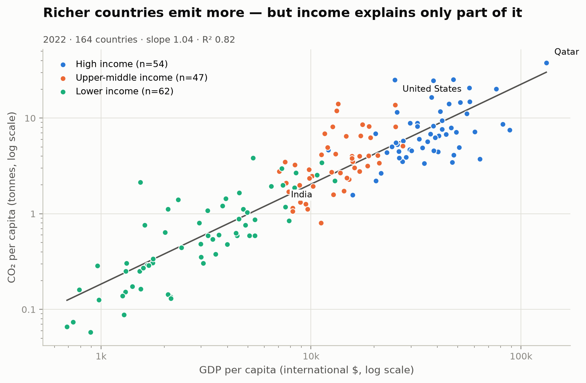

# Yufeng Zhang

*Data Science student · University of Macau*

I turn messy, real-world data into clear answers: cleaning and auditing the raw
records first, then using exploratory analysis and simple, interpretable models
to say what the data actually supports. This page collects my data science work,
starting with a study of income and carbon emissions across 164 countries.

---

## Technical skills

- **Programming:** Python, SQL basics, Git and GitHub
- **Data analysis:** pandas, NumPy, data cleaning, missing-data handling, exploratory analysis
- **Statistics and modelling:** regression, hypothesis testing, model evaluation
- **Visualization:** Matplotlib, chart design for non-specialist readers
- **Reproducibility:** virtual environments, `requirements.txt`, scripted pipelines

---

## Project showcase

### Income, CO₂ and the last three decades

**Research question:** How closely does a country's income per person track its
CO₂ emissions per person, and how have per-capita emissions moved across income
groups since 1990?

The analysis covers 164 countries in 2022. A log-log regression of CO₂ per capita
on GDP per capita has a slope of 1.04 and an R² of 0.82, so income explains most
— but not all — of the difference between countries. Using a 1990–2023 panel
joined to World Bank income groups, I found that the population-weighted average
fell by 23% in high-income countries while it rose by 132% in upper-middle-income
countries. The largest country-level falls were in Estonia, Ukraine and Czechia;
the largest rises in Trinidad and Tobago, Oman and Mongolia.

The full write-up, code, data notes and two further figures are in the project
repository.

- **Repository:** [github.com/yufengsam/data-science-project](https://github.com/yufengsam/data-science-project)
- **Status:** completed

### More projects

This portfolio is growing. The next case study will be added here.

---

## About this site

Built with GitHub Pages. Source for this page:
[data-science-portfolio](https://github.com/yufengsam/data-science-portfolio).

*Last updated: October 2026.*
